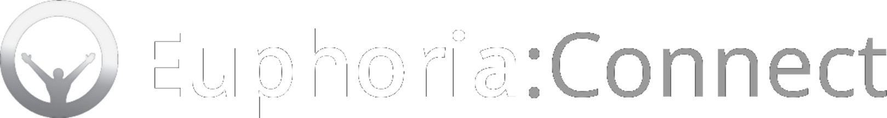

# Euphoria:Connect

**Euphoria-style active ragdolls for your games and Unity projects.**

Made by Marii.

Euphoria:Connect runs the Euphoria active-ragdoll runtime on your PC and plugs it into games and Unity. Characters
don't just flop over when they get hit: they stagger, try to keep their balance, put their arms out to break a fall,
hold their wounds, and get back up.

**[Download the latest version](https://github.com/Marii-dev/EuphoriaConnect/releases/latest)** ·
**[Join the Discord](https://discord.gg/95npVRknen)**

---

## What it does

- **Shot, hit or knocked over:** characters stumble, catch themselves, step to keep their balance and protect
  their head, instead of turning into a limp ragdoll.
- **Wounds:** shot characters grab where they were hit and hold it.
- **Falls:** they react to falls, ledges and stairs, and land on the real floor.
- **Getting back up:** once things settle down, they get up and carry on (NPCs go back to being normal NPCs).
- **Deaths:** killed characters stagger and crumple. Turn on **Killshot** and a killing head shot drops them on the spot.
- **Grabbing:** pick them up or drag them (physgun, hands, telekinesis) and they struggle instead of hanging there.
- **The world:** walls, floors, railings and props are copied into Euphoria, so the body reacts to what's around it.

## Supported

| | What happens |
|---|---|
| **Garry's Mod** | Shot NPCs and ragdolls react with Euphoria. Spawn your own Euphoria characters too. |
| **Blade & Sorcery** | Creatures you hit hard, knock down or kill react with Euphoria. |
| **BONELAB** | NPCs you shoot, hit or kill react with Euphoria (through MelonLoader). |
| **Unity** | A plugin for your own projects: drop a Euphoria character into any scene. |

More games are being looked at. You can suggest one with the **Suggest a game** button in the app.

## What you need

- 64-bit Windows 10 or 11
- The game you want to use it with (PC / Steam version)
- That's it. Nothing else to install. (.NET 8 is optional and only adds crash reports.)

---

## Getting started

1. Download `EuphoriaConnect-x.x.x.zip` from **[Releases](https://github.com/Marii-dev/EuphoriaConnect/releases/latest)**.
2. Unzip it wherever you want and keep everything inside the folder together.
3. Run **EuphoriaConnect.exe**. The first time, it puts a shortcut on your desktop too.
4. If Windows asks about network access for `EuphoriaRuntime.exe` or `EuphoriaBridge.exe`, you can cancel it. They only
   talk to programs on your own PC.

Then pick your game below.

### Garry's Mod

1. In Euphoria:Connect, go to **Games**, pick Garry's Mod and hit **Install**. Close the game first if it's open.
2. Turn it on with the switch and hit **Launch**.
3. Load into a single-player map and try any of these:
   - Shoot an NPC (citizens, combine, metrocops).
   - Type `euphoria_spawn` in the console to spawn a Euphoria character where you're looking.
   - Hold **C** and right-click a ragdoll for **Make Euphoria**, **Get up** and more.
   - Grab them with the physgun.

Works on both the normal 32-bit version and the x86-64 beta.

### Blade & Sorcery

1. You need the PC (Steam) version. Script mods don't work on Nomad.
2. In Euphoria:Connect, go to **Games**, pick Blade & Sorcery and hit **Install**. Close the game first if it's open.
3. Turn it on and hit **Launch**.
4. Hit a creature hard, knock it down or kill it.

### BONELAB

1. Works with the Steam or Meta PC version. If BONELAB isn't found, hit **Browse** and pick the folder with its exe.
2. In Euphoria:Connect, go to **Games** and pick BONELAB. Under **MelonLoader**, hit **Install**. This downloads the
   MelonLoader version I've tested, from its official GitHub.
3. Start BONELAB once and let it finish its first-time setup (takes a few minutes), then close it.
4. Hit **Install** for the mod, turn BONELAB on and start the game.

### Unity

1. Your project needs Unity 2021.3 LTS or newer (I've tested on Unity 6000.3).
2. In Euphoria:Connect, pick **Unity**, choose your project with **Browse** and hit **Install**.
3. Turn Unity on.
4. In Unity: **Tools > Euphoria > Create Starter Scene**, then hit **Play**. Or add a `EuphoriaCharacter` to an object in
   your own scene.

The plugin comes with its own guide (`Assets/EuphoriaPlugin/README.md`) covering your own rigs, hitting characters from
code, and the world.

---

## Updating

Euphoria:Connect updates itself. When a new version is out, an **Update** button appears in the top bar. Click it and
Connect downloads the update, installs it and restarts. The game mods you've installed are updated too.

Every version's changes are listed in the app under **About > Changelog**, and on the
**[Releases page](https://github.com/Marii-dev/EuphoriaConnect/releases)**.

## Tuning

Each game has a **Tuning** tab in Euphoria:Connect. Change how characters balance, step, protect themselves, how hard
hits push them, how long they stay down and more. Changes apply live while you play, so you can try things out straight
away.

You can also give the app your own look in **Settings > Background**: pick a colour or gradient.

## Uninstalling

- **From a game:** open its page in Euphoria:Connect and hit **Uninstall**. Everything Euphoria added to that game is
  removed. (For BONELAB, MelonLoader stays: it has its own Remove button, since other mods may need it.)
- **Euphoria:Connect itself:** close it and delete its folder. Your settings are in `%APPDATA%\EuphoriaConnect` if you
  want to remove those too.

---

## Garry's Mod console commands

| Command | What it does |
|---|---|
| `euphoria_spawn` | Spawns a Euphoria character where you're looking. |
| `euphoria_convert` | Turns the ragdoll you're looking at into a Euphoria character. |
| `euphoria_request GetUp` | Sends a request to the character you're looking at (or all of them), e.g. `GetUp`. |
| `euphoria_status` | Shows whether Euphoria is connected and how many characters are active. |
| `euphoria_restart` | Reconnects to Euphoria:Connect. |
| `euphoria_show 1` | Draws the actual Euphoria body (its collision shapes and skeleton) over every character. `0` turns it off. |
| `euphoria_killshot 1` | A killing head shot drops NPCs on the spot. `0` (default): they stagger, then crumple. |
| `euphoria_verbose 1` | Logs more detail in the console. Turn it on when reporting a bug. |

Most other settings are in the **Tuning** tab, so you don't need to type them.

## Something broke?

- Hit **Show consoles** in Settings to see what the runtime and bridge are saying.
- If the runtime crashes, there's a report in `Runtime\CrashCatcher\crash_report.txt` (needs .NET 8 installed).
- **Garry's Mod:** console messages starting with `[Euphoria]` tell you what went wrong. `euphoria_verbose 1` adds more,
  and `euphoria_show 1` shows what the Euphoria body is doing.
- **BONELAB:** check `MelonLoader\Latest.log` in the game folder.
- **"module missing" in Garry's Mod:** hit **Install** again in Euphoria:Connect with the game closed.
- **"Euphoria's files don't match the release":** a file in the app's folder was changed or added. Download and unzip
  Euphoria:Connect again.

Still stuck? Use the **Report a bug** button in the app. It sends me your report and any screenshots or logs you attach.
Or ask on the **[Discord server](https://discord.gg/95npVRknen)**.

---

## FAQ

**Does it work in multiplayer?**
It's made for single-player. Garry's Mod servers may work, but that isn't tested.

**Do I need to keep Euphoria:Connect open?**
Yes. It runs the Euphoria runtime that the games talk to. Switch the game on in the app, then play.

**Can I use it with other mods?**
Usually yes. If something clashes, report it with the **Report a bug** button.

**Can I play more than one game with it at once?**
Garry's Mod, Blade & Sorcery and BONELAB share one runtime, so play one at a time.

---

## Community

Join the **[Discord server](https://discord.gg/95npVRknen)** for update news, help, sharing clips and suggesting games.

## Support

If you enjoy it, you can support development on **[Ko-fi](https://ko-fi.com/djmarii)**.

## Credits

Made by Marii.

MelonLoader (used for BONELAB) is by LavaGang and is downloaded from its official releases.
